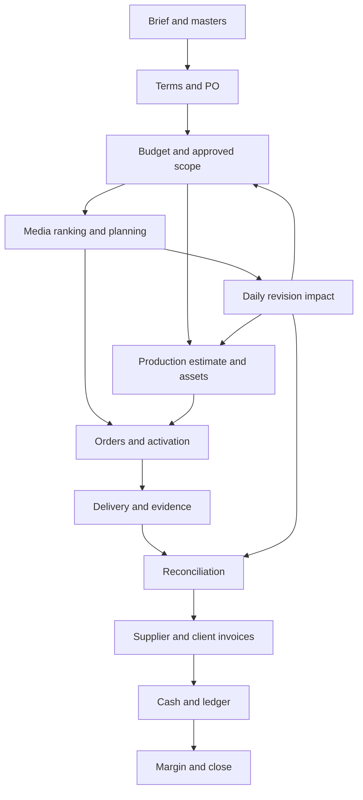

# Runtime and agent wiring

The included layer is operational skills + deterministic read-only tools + input normalization + evaluation contracts. Reuse the host's LLM, memory, file access and enabled marketplace apps. This repository does **not** include a hosted execution engine, payment gateway, secret vault, durable transactional database or public web deployment. Installing skills cannot grant those capabilities.

## Dependency and state model

The orchestrator reads current artifacts and selects stages; specialist skills work only on dependency-ready inputs. A specialist can be one invocation in the same assistant; users need not pay for 42 concurrent LLMs. A custom host can run independent read/preparation work concurrently, while serializing writes against shared PO/account/order/period state.

Each handoff carries tenant/client/job/run, stage/revision, currency/period, source evidence, result status, named artifact references, blockers, approval needs and next stage. `contracts/handoff-schema.json` specifies a strict shared envelope; artifact contents still require a reviewed domain schema in the host. `contracts/workflows.json` is the routing catalogue. Never use prose agreement as a ledger state transition.

Statuses: draft, validated, pending_approval, approved, executing, completed, blocked, failed, uncertain. The host authenticates transitions and preserves event/checkpoint history. Revalidate upstream revisions when resuming. A partially executed revision may contain both completed and uncertain actions. Do not repeat completed financial actions or overwrite posted history.

## Map of requested controls

| Requirement | Included | Host responsibility |
|---|---|---|
| Tools/context/memory/MCP | Self-contained skills, typed local tools, provider registry, file routes | Credentials, live discovery, client-scoped persistent memory |
| Evals before prompts | Synthetic acceptance suite and deterministic evaluation harness | Held-out real host/model tests before prompt/model release |
| Live tryable link | Offline CLI demo | Publish a real service if required; no invented live URL |
| Small/reasoning routing | Task-classification and escalation contract | Choose evaluated model IDs/providers dynamically; cost-aware routing |
| Token/time/cost limits | Starter policy and trajectory checks | Enforce aggregate run budget across every agent/retry/fallback |
| Cache | Scope/invalidation contract | Store read-only results with tenant/account/scope/version keys |
| Backoff | Bounded-read retry policy; unknown-write handling | Timed backoff with jitter/Retry-After; deadline and error classification |
| Strict tool output | Strict local schemas + validation | Reviewed schema/version for every external tool and inner meta-action |
| Resume | Artifact/checkpoint and revision protocol | Durable transactional checkpoints and action ledger |
| Sandbox/least privilege | Local arithmetic has no network or writes | Isolate process/egress/credentials for each tool; HTTP MCP alone is insufficient |
| Secrets/PII | Explicit ingestion boundary and narrow import formats | Redact before model invocation, restrict original evidence and scrub traces |
| Injection resistance | Untrusted-document procedure and cases | Separate policy/tool authority from source content; block unsafe calls |
| Human approvals | Bound payload/action/revision protocol | Authenticated approval store, expiration, roles and pre-execution gate |
| Traces | Observable trajectory format/evaluator | Sanitized model/tool/decision events, receipts, checkpoints, costs |
| Trajectory evaluations | Deterministic observable checks, behavior cases | Independent rubric review, host traces and business-state assertions |
| Real failure suite | Contribution format and synthetic labeling | Consented/deidentified production failures; no invented provenance |
| CI regression gate | Required package/tool/fixture checks | Add authenticated host model eval artifact and critical thresholds |
| A/B models | Shadow then bounded rollout procedure | Real traffic assignment, approval-preserving rollout and rollback |
| Task-level cost | Cost-per-completed-task definition | Attribute model/tool/retry/failure/review costs and completion state |
| Fine-tune small models | Eligibility/review/holdout process | Rights-cleared production corpus, training and evaluated deployment |
| Backup model | Shared-policy fallback contract | Evaluated backup, tool/schema compatibility, remaining budget |

## Model, memory and permissions

Start with the user's existing model and avoid unnecessary agent calls. Low-complexity extraction/classification can route to an evaluated small model; conflicting evidence, complex revisions and accounting exceptions require a reasoning profile. Deterministic money arithmetic stays in tools. The host sets actual model names/capabilities, not these portable skills. Fallback preserves checkpoints, approvals and the **remaining** aggregate budget. No fresh quota on provider failure.

Memory partitions by tenant/client/job and stores deidentified facts with provenance, revision and retention. Keep original files/PII in a restricted evidence store. Do not load every client's memory into every stage. Use the smallest task context and actual tool allowlist; marketplace apps and broad aggregators expose more capabilities than this task may need. Validate inner Composio actions and Stripe HTTP resource/method, never approve just the generic wrapper.

Budget reservation is transactional and idempotency is provider-dependent. The calculators only evaluate a snapshot. Unknown write outcome requires a query/reconciliation path; no exactly-once guarantee across arbitrary third-party APIs. Production hosts must test their gate, crash/restart, concurrent-reservation and timeout behavior before live writes.

## Evaluation and rollout

Run package tests and deterministic fixtures locally and in CI. Then forward-test skills without gold answers in the selected host using isolated redacted fixtures, real tool schemas and bounded runtime. Export observable actions and resultant state; evaluate correctness, evidence, authorization, recovery, task cost and latency. A trace declaration cannot replace a provider receipt or proof of runtime enforcement. Synthetic fixtures do not establish an LLM success rate.

Shadow a new model without writes, evaluate held-out cases, then use a small opt-in traffic cohort with unchanged approval gates. Block critical failures regardless of average score. Define actual baseline and threshold in the host, never fabricate one. Track cost per successful task including failures/retries, and human active minutes/rework; measure waiting separately. Only then consider reviewed deidentified fine-tuning of smaller models.
