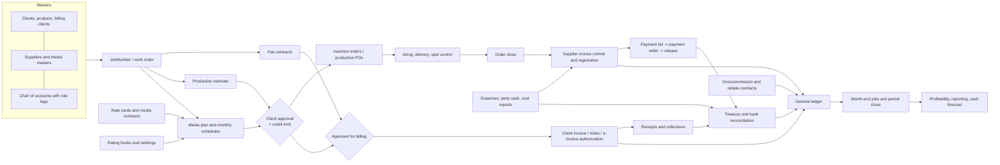

# Agency ERP end-to-end circuit

> **Provenance.** This map consolidates the functional reverse engineering in this folder, derived from the public help documentation of a reference agency ERP (~1,330 pages reviewed 2026-10-11). It is a paraphrased model of *what the business circuit does*, not vendor documentation or source code. Defaults marked *configurable* differ between agencies; items marked *confirm locally* were ambiguous in the source.

Every skill links this file. Read it to place a request in the circuit, then open the domain reference the skill names.

## 1. The circuit in one picture

## 2. Shared identifiers and states

- **JobNumber** (campaign/project, a.k.a. `OT` work order) is the anchor of everything: estimates, plans, orders, tasks, hours, expenses, supplier and client invoices. In the reference ERP it is a 12-character code: client (3) + product (2) + year digit (1) + typology (1) + billing code (1: `F` one client, `0` non-billable, `?` client pending, `*` split) + sequence (4). Typologies such as new business, presentations and own advertising forbid sales values; collateral jobs block media plans (*configurable*). Tool: `job_number`. Skill: `agency-job-lifecycle`.
- **Pending to bill** (`pendiente de facturar`) is created when a plan, estimate line or fee instalment is client-approved and approved for billing; client invoicing consumes it.
- **Pending to receive** (`pendiente de recibir`) is created when an order, PO or expense request is issued; supplier invoices consume it at spot, item or request-line grain, leaving **differences** open until a credit/debit note or an approved write-off.
- **Document approval chain:** draft → client-approved (credit limit checked first) → approved for billing → billed. Each step is a separate permission and can only be reversed while the next step has not happened.
- **Period states:** open → pre-closed (subledger by subledger; operations stop posting) → closed. Reopening a month reopens every later month and removes automatic close entries.
- **Statuses used by every skill's handoff:** `draft`, `validated`, `pending_approval`, `approved`, `executing`, `completed`, `blocked`, `failed`, `uncertain` (see `control-contract.md`).

## 3. Gates that must never be skipped

| Gate | Where | Rule (reference default) | Skill |
|---|---|---|---|
| Open job | every document | Documents attach only to open, correctly typed jobs | agency-job-lifecycle |
| Credit limit | before client approval of plans/estimates | open AR + approved unbilled + new amount ≤ limit, else override approval | agency-budget-control |
| Client PO / budget reserve | client approval | PO balance net of tax; only documents created after the PO | agency-contract-po |
| Media approval circuit | before orders | None / Restricted / Strict (*configurable*) | agency-media-planning |
| Supplier selected | before production PO | one chosen supplier per externally bought line | agency-production-estimating |
| Mandatory PO / PO approval | before supplier invoice | optional switches | agency-production-estimating, agency-payables |
| Order closed | before supplier media invoice | closing auto-certifies unverified spots; no reopen after an invoice exists | agency-media-buying, agency-transmission-control |
| Approved for billing | before client invoice | separate permission from client approval | agency-client-billing |
| Fiscal authorization | before delivery of an e-invoice | consecutive authorization per point of sale | agency-tax-compliance |
| Two-person payment list | before payment orders | preparer ≠ approver; a provisional list locks its invoices | agency-payment-run |
| Release | payment accounting | no entry until release assigns instruments | agency-payment-run |
| Pre-close | before close jobs | one income provision per month; no posting into pre-closed periods without permission | agency-period-close |

## 4. Account role tags

The reference ERP drives automatic postings through *observation codes* on accounts instead of hard-coded account numbers. Treat them as role tags in your own chart of accounts (`agency-general-ledger`, `agency-master-data`):

- Control accounts with subledger: clients (48), suppliers (30), subaccounts (82), expenses to account for (83), cost reports (84), staff subaccounts (85).
- Income: agency service/commission (20), fees (22), bonuses (23). Media and production types carry their own sales, cost, rebate and difference accounts.
- Taxes: VAT credit/debit by rate (08–13), VAT payable (17), customer VAT withholding (18), non-computable VAT (I7), gross-receipts tax by jurisdiction (A0, A1, A2, AI, 60, IP).
- Means of payment: cash (40/41), values to deposit (42/52), banks (43), notes (46/47), client advances (50), petty cash (51), deferred cheques (53/93), supplier advances (32).
- Close: bridge accounts (01–05), work in process (86/WP, *confirm locally*), provisions (PI, PE, PH, PC, PP, PA, PG), overcommission provisions (PO/PD), intercompany (IC), result of the year (90), fixed assets (B1–B8, BR), inflation result (AC).

Full table: `accounting.md` §3.3 (docs/erp-reference in the repository; mirrored into skills that own ledger work).

## 5. Coverage matrix: reference ERP module → skills

| ERP module (menu) | Main processes | Skills | Deterministic tools |
|---|---|---|---|
| Sistemas / General | parameters, users, profiles, approval powers, audit, contacts, alerts | agency-access-governance, agency-integrations, agency-orchestrator | payload_digest |
| Cuentas: maestros | owner clients, products, attention groups, provisional approval | agency-onboarding, agency-master-data | job_number |
| Cuentas: trabajos | JobNumber open/move/substitute/re-bill/close, brief, contact reports | agency-job-lifecycle, agency-onboarding | job_number |
| Cuentas: tareas, timesheet | task workflow, hours, approval, chargeability | agency-tasks-timesheets | allocate, hourly_fee_settlement |
| Cuentas: contratos | fixed and hourly fee contracts, client POs, budget reserves | agency-fee-contracts, agency-contract-po, agency-budget-control | hourly_fee_settlement, installment_schedule, budget_check, credit_exposure |
| Presupuesto de ingresos | revenue budget versions and projection | agency-revenue-budget | allocate, margin |
| Producción | estimates, quotes, award, client/billing approval, POs, advances, royalties, events, overrides | agency-production-estimating, agency-production, agency-rebates | estimate_totals, credit_exposure, tiered_commission |
| Medios: maestros | media types, outlets, programs, dayparts, duration factors, targets, taxonomy | agency-master-data | media_line_cost |
| Medios: planificación | books, rankings, plans, schedules, approval, materials, evaluation, digital | agency-media-ranking, agency-media-planning, agency-tv-radio-planning, agency-ooh-planning, agency-digital-planning, agency-plan-changes | audience_metrics, media_line_cost, discount_cascade, plan_diff |
| Medios: compra | rate cards, media contracts, orders, versioning, close | agency-rate-cards-contracts, agency-media-buying | discount_cascade, installment_schedule, credit_exposure |
| Medios: control de avisos | monitoring import, matching, makegoods | agency-transmission-control | spot_match, reconcile |
| Medios: overcomisiones | volume/override contracts, incentives, finder fees | agency-rebates, agency-accruals-revaluation | tiered_commission, flat_rebate, allocate |
| Medios: digital execution | activation, optimization (outside the reference ERP) | agency-campaign-activation, agency-campaign-optimization | budget_check, plan_diff, audience_metrics |
| Carteles vía pública | seller-side billboard inventory | agency-ooh-inventory | media_line_cost, discount_cascade |
| Gastos | contracts, requests, POs, expense sheets, cost sheets, petty cash, budget | agency-expenses, agency-fixed-assets | allocate, installment_schedule, invoice_check |
| CxC: facturación | pending to bill, invoices, notes, annexes, advance sales, supplier commissions | agency-client-billing, agency-billing-requirements, agency-rebates | discount_cascade, estimate_totals, invoice_check, payment_terms |
| CxC: cobranzas | receipts, applications, advances, aging, credit | agency-collections | aging, credit_exposure, withholding |
| CxP: facturación proveedores | load types, control vs register, differences, credit notes, advance purchases | agency-payables, agency-delivery-reconciliation | invoice_check, reconcile, spot_match |
| CxP: pagos / Tesorería | payment lists, orders, release, withholdings, bank files, deposits, cheques, reconciliation | agency-payment-run, agency-cash-settlement | withholding, payment_terms, fx_revaluation, journal_check |
| Contabilidad | chart of accounts, entries, provisions, FX, WIP, fixed assets, taxes, close | agency-general-ledger, agency-accruals-revaluation, agency-fixed-assets, agency-tax-compliance, agency-period-close | journal_check, fx_revaluation, depreciation_schedule, aging |
| Management | cash flow projection, monthly reporting, profitability | agency-cash-forecast, agency-management-reporting, agency-profitability | cash_projection, margin, allocate |

## 6. What the reference does not settle

- Training ("Academia") pages are video titles only; forecast, segregation-of-duties and several master screens are stubs.
- Formulas left implicit: discount cascade (compound assumed, additive available), CPR/CPM/affinity (industry definitions), marginal vs slab for some incentive scales, hourly-fee overage split, proration of OOH orders across months, withholding formulas per country.
- Country coverage is deepest for Argentina, then Colombia; Mexico appears mainly through CFDI stamping, counter-receipts and TV Azteca/Televisa specifics. Supply your own tax tables, e-invoicing provider and statutory layouts.

Each skill lists these as *confirm locally* where they matter, unless the agency fixes them in `AGENCY.md` (section 7). Contribute verified rules back with evidence (see CONTRIBUTING.md).

## 7. Agency policy overlay (AGENCY.md)

What the reference leaves *configurable* or *confirm locally*, an agency fixes once in `AGENCY.md` ([agency-policy.md](../agency-policy.md)). The circuit itself does not change: the overlay only parameterises its gates.

| Circuit point | AGENCY.md section | Effect |
|---|---|---|
| JobNumber typology | `jobs.typologies` | which typology letters exist and which forbid sales values |
| Credit limit gate | `approvals` (`credit_override`), `collections` | who may override and how often limits are reviewed |
| Client approval of plans and estimates | `approvals` (`client_estimate`, `plan_change`), `commercial.plan_change_tolerance_bps` | approver per amount tier; size of change that reopens approval |
| Orders, POs, launch | `approvals` (`media_order`, `production_order`, `campaign_launch`), `connectors` | approver per tier; which platforms may receive an approved order |
| Supplier invoice control | `approvals` (`supplier_invoice`), `taxes`, `accounting.accounts` | approver, reviewed rates, payable accounts |
| Client billing and notes | `approvals` (`client_invoice`, `credit_note`), `taxes`, `commercial` | approver, VAT and withholding rates, terms and agency fee |
| Two-person payment list and release | `approvals` (`payment_run`, `cash_settlement`), `segregation_of_duties` | the two roles per tier; preparer never approves |
| FX and accruals | `fx`, `accounting` | rate source, revaluation cadence, accrual and FX accounts |
| Pre-close and close | `accounting.close_day`, `approvals` (`journal_entry`, `period_reopen`, `write_off`) | calendar and who may post, reopen or write off |
| Masters and access | `approvals` (`master_data_change`, `access_change`), `roles` | who changes suppliers, banks, accounts and permissions |

Route every approver with `approval_route` and carry `policy_version` through the handoff. Without a valid overlay the gates still apply, with approvers and values marked *confirm locally*.

